<div align="center">

  <!-- Animated Header Banner -->
  <a href="https://codex404solutions.online/">
    
  </a>

  <br/><br/>

  <!-- Dynamic Animated Typing SVG -->
  <a href="https://github.com/mnoukhej">
    
  </a>

  <br/>

  <!-- Quick Action & Connect Badges -->
  <p>
    <a href="https://www.linkedin.com/in/mnoukhej/" target="_blank">
      
    </a>
    <a href="https://codex404solutions.online/" target="_blank">
      
    </a>
    <a href="mailto:mnoukhej@gmail.com">
      
    </a>
    <a href="https://wa.me/917717747620" target="_blank">
      
    </a>
    <a href="https://github.com/mnoukhej/portfolio" target="_blank">
      
    </a>
  </p>

</div>

---

### 👨‍💻 About Me

I am a **Senior Python Developer & AI Systems Architect** with **7+ years of enterprise experience** building mission-critical software, machine learning solutions, and generative AI systems at **Tata Consultancy Services (TCS)** within core **Research & Innovation (RnI)** and **Research & Development (RnD)** teams.

In addition to enterprise engineering, I am the founder of **[CodeX404 Solutions](https://codex404solutions.online/)**, where we design and deploy scalable AI-driven web architectures, automated pipelines, and intelligent software for modern businesses.

```python
class MuhammadNoukhez:
    def __init__(self):
        self.name = "Muhammad Noukhez"
        self.location = "Kolkata, India (Open to Global Remote / Relocation)"
        self.degree = "Master of Technology (M.Tech) in Computer Science"
        self.enterprise_tenure = "7+ Years @ Tata Consultancy Services (TCS)"
        self.venture = "Founder & Tech Lead @ CodeX404 Solutions"
        self.core_stack = ["Python", "FastAPI", "Azure OpenAI", "React", "Docker"]
        
    def current_mission(self):
        return "Architecting enterprise GenAI agents, RAG pipelines, and high-throughput microservices."
```

---

### ⚡ Enterprise & Technical Highlights

<table>
  <tr>
    <td width="50%">
      <h4>🏢 Enterprise Pedigree (TCS RnI & RnD)</h4>
      <ul>
        <li><b>7+ years</b> architecting resilient Python web services, asynchronous microservices, and automated data pipelines.</li>
        <li>Led research initiatives delivering <b>Azure OpenAI LLM applications</b> to solve complex business domain challenges.</li>
        <li>Specialized in P1/P2 incident resolution, SLA compliance, and zero-downtime database optimization.</li>
      </ul>
    </td>
    <td width="50%">
      <h4>🤖 GenAI & Machine Learning</h4>
      <ul>
        <li>Production <b>Azure OpenAI & LLM</b> applications with RAG (Retrieval-Augmented Generation) architectures.</li>
        <li>Deep learning & computer vision pipelines using <b>PyTorch, TensorFlow, YOLO, and OpenCV</b>.</li>
        <li>Statistical modeling, feature engineering, and high-precision predictive classifiers (NSL-KDD, NLP).</li>
      </ul>
    </td>
  </tr>
  <tr>
    <td width="50%">
      <h4>⚡ High-Performance Web & APIs</h4>
      <ul>
        <li>High-throughput asynchronous APIs with <b>FastAPI, Django, and Flask</b>.</li>
        <li>Contract-first API design, authentication (OAuth2/JWT), rate-limiting, and microservices architecture.</li>
        <li>Relational & NoSQL database modeling with <b>PostgreSQL, MySQL, and MongoDB</b>.</li>
      </ul>
    </td>
    <td width="50%">
      <h4>🌐 Full-Stack & Venture Delivery</h4>
      <ul>
        <li>Responsive user interfaces with <b>React.js, Node.js, and modern CSS/Tailwind</b>.</li>
        <li>Containerized deployments via <b>Docker, CI/CD pipelines, and cloud infra</b>.</li>
        <li>Founder at <b>CodeX404 Solutions</b>, shipping end-to-end digital solutions for modern businesses.</li>
      </ul>
    </td>
  </tr>
</table>

---

### 🛠️ Tech Stack & Tooling

<div align="center">

| Domain | Technologies & Frameworks |
| :--- | :--- |
| **Languages** |      |
| **AI, GenAI & ML** |        |
| **Backend & APIs** |       |
| **Frontend** |     |
| **Databases & Cloud** |       |

</div>

---

### 📂 Featured Works & Repositories

<table>
  <tr>
    <td width="50%" valign="top">
      <h3>🚀 <a href="https://codex404solutions.online/">CodeX404 Solutions</a></h3>
      <p>Tech innovation venture providing custom AI systems, full-stack digital platforms, and enterprise software engineering.</p>
      <sub><b>Founder &amp; Tech Lead</b> • GenAI · Web Platforms · Cloud Architecture</sub>
      <br/><br/>
      <a href="https://codex404solutions.online/">🌐 Visit Website</a>
    </td>
    <td width="50%" valign="top">
      <h3>🛡️ <a href="https://github.com/mnoukhej/Instrusion-Detection-System">Intrusion Detection System</a></h3>
      <p>Machine learning classification pipeline analyzing network traffic patterns to detect cyber anomalies using the benchmark NSL-KDD dataset.</p>
      <sub><b>Python</b> · scikit-learn · Pandas · Network Security · Jupyter</sub>
      <br/><br/>
      <a href="https://github.com/mnoukhej/Instrusion-Detection-System">⭐ Explore Repository</a>
    </td>
  </tr>
  <tr>
    <td width="50%" valign="top">
      <h3>📧 <a href="https://github.com/mnoukhej/Spam_Email_Detection">Spam Email Detection Engine</a></h3>
      <p>Natural Language Processing (NLP) and supervised classification system accurately distinguishing malicious spam from legitimate correspondence.</p>
      <sub><b>Python</b> · NLP · Machine Learning · Text Vectorization · Scikit-Learn</sub>
      <br/><br/>
      <a href="https://github.com/mnoukhej/Spam_Email_Detection">⭐ Explore Repository</a>
    </td>
    <td width="50%" valign="top">
      <h3>🎓 <a href="https://github.com/mnoukhej/Student-Management-System_Django">Student Management System</a></h3>
      <p>Full-stack enterprise Django application managing course enrollments, student records, fee tracking, and academic scheduling with role-based auth.</p>
      <sub><b>Python</b> · Django · SQLite/PostgreSQL · Bootstrap · HTML/CSS</sub>
      <br/><br/>
      <a href="https://github.com/mnoukhej/Student-Management-System_Django">⭐ Explore Repository</a>
    </td>
  </tr>
  <tr>
    <td width="50%" valign="top">
      <h3>💼 <a href="https://github.com/mnoukhej/portfolio">Personal Portfolio & Showcase</a></h3>
      <p>Interactive web application showcasing software architecture, live project demos, professional achievements, and direct client touchpoints.</p>
      <sub><b>Full-Stack</b> · HTML5 · CSS3 · Vanilla JS · Responsive Design</sub>
      <br/><br/>
      <a href="https://github.com/mnoukhej/portfolio">⭐ Explore Repository</a>
    </td>
    <td width="50%" valign="top">
      <h3>🔬 Medical Diagnostic ML Classifiers</h3>
      <p>Advanced diagnostic ML models predicting disease indicators including Complete Blood Count (CBC) analysis and malignant cell detection.</p>
      <sub><b>Python</b> · Healthcare AI · Predictive Modeling · Data Science</sub>
      <br/><br/>
      <a href="https://github.com/mnoukhej?tab=repositories">⭐ Explore All Repositories</a>
    </td>
  </tr>
</table>

---

### 📊 GitHub Activity & Metrics

<div align="center">
  <table border="0">
    <tr>
      <td>
        
      </td>
      <td>
        
      </td>
    </tr>
  </table>

  <br/>

  <a href="https://github.com/mnoukhej">
    
  </a>
</div>

---

### 📬 Let's Connect & Collaborate

I am continuously open to **Senior Python Developer**, **AI/GenAI Engineer**, and **Systems Architect** roles, high-impact consulting engagements, and venture partnerships.

<div align="center">

[](https://www.linkedin.com/in/mnoukhej/)
[](https://codex404solutions.online/)
[](mailto:mnoukhej@gmail.com)
[](https://wa.me/917717747620)
[](https://x.com/mnoukhej)

<br/>

<sub>© 2026 Muhammad Noukhez • Designed with precision, modern architecture & clean code.</sub>

</div>
