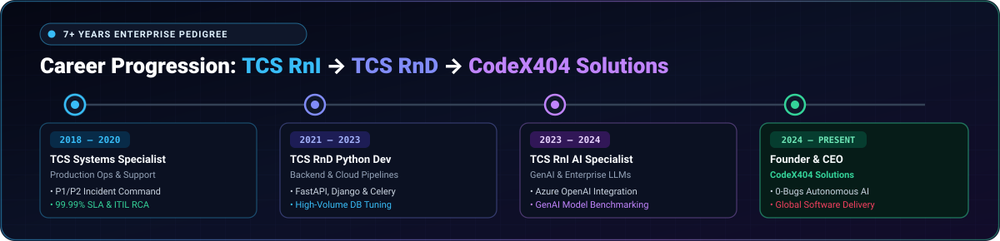

  <!-- ==================== 1. MASTER EXECUTIVE ANIMATED BANNER ==================== -->
  

    

  <!-- ==================== 2. INFINITE TECH MARQUEE SCROLLER ==================== -->
  

    

  <!-- ==================== 3. RESPONSIVE DYNAMIC TYPING SUBTITLE ==================== -->
  

   

  <!-- ==================== 4. HIGH-IMPACT TOUCHPOINT PILLS (SAFE WRAP) ==================== -->
  

    
    
    
    
    
  

---

### 👨‍💻 Executive Summary & Engineering Philosophy

I am a **Senior Python Developer & AI Systems Architect** with **7+ years of enterprise engineering experience** at **Tata Consultancy Services (TCS)** across **Research & Innovation (RnI)** and **Research & Development (RnD)** divisions.

I am also the **Founder & CEO** of **[CodeX404 Solutions](https://codex404solutions.online/)**, a senior engineering studio delivering production-grade custom software, autonomous AI agent systems, private enterprise RAG architectures, and cloud workflow pipelines for clients across **India, the US, UK, UAE, Saudi Arabia, Canada, and Australia**.

> 💡 **The Core Thesis:** *"Where Bugs Meet Their Match — We design, engineer, and deploy high-throughput software systems built on strict type-safety, automated idempotency, 99.99% SLA adherence, and 100% client intellectual property ownership."*

 

<!-- ==================== 5. ANIMATED ENTERPRISE METRICS MOTION SLIDER ==================== -->

  

---

### 🏢 CodeX404 Solutions — Flagship Venture

  

 

**[CodeX404 Solutions](https://codex404solutions.online/)** operates on three uncompromising engineering pillars:

- 🎯 **100% Senior Direct Engineering** — Direct technical leadership with zero junior handoffs, miscommunication, or agency overhead.
- 🐛 **Deterministic Zero-Defect Guarantee** — Strict static typing, exhaustive boundary condition tests, and vulnerability elimination.
- 🔓 **Zero Vendor Lock-In** — Clients receive 100% intellectual property (IP), clean modular source code, and containerized deployment pipelines.

#### Core Solution Capabilities:
1. **🤖 Autonomous AI & Private RAG Systems**
   - Private RAG knowledge engines engineered with **Qdrant, Pinecone, and Azure OpenAI**.
   - Multi-tool autonomous agentic workflows for real-time customer inquiry resolution, CRM synchronization, and intelligent document parsing.
2. **⚡ Custom Cloud Software & SaaS Platforms**
   - Low-latency web services built with **Python (FastAPI, Django, Flask)**, **Node.js**, and **React**.
   - Sub-50ms API response times (p99), Lighthouse 99+ scores, and resilient cloud architectures.
3. **🔄 Workflow & Business Process Automation**
   - End-to-end integration across WhatsApp Business API, CRM platforms, Stripe/Razorpay payment gateways, and automated webhook dispatchers.
4. **🏫 Institutional Web Platforms & ERPs**
   - High-throughput portals such as **[Insan Degree College](https://insandegreeclg.codex404solutions.online)** (handling **25,000+ monthly active visits** during peak admission season with zero downtime).

---

### 💼 Enterprise Career Pedigree (Tata Consultancy Services)

  

 

Over **7+ years at TCS**, I contributed to critical enterprise software, research initiatives, and operational reliability:

- **Specialist Programmer / Senior Developer — AI, ML & GenAI** *(07/2023 – 02/2024)*
  - **Research & Innovation Team (RnI)**
  - Spearheaded enterprise application development using **Azure OpenAI LLMs** to automate domain-specific business processes.
  - Developed and deployed high-performance Python microservices leveraging **FastAPI, Django, and Flask**.
  - Benchmarked, fine-tuned, and containerized Machine Learning and Generative AI pipelines for production readiness.

- **Python Backend Developer** *(11/2021 – 06/2023)*
  - **Research & Development Team (RnD)**
  - Engineered resilient Python web applications, automated asynchronous data pipelines, and third-party API integrations.
  - Managed high-volume database architectures with **PostgreSQL, MySQL, and MongoDB**, ensuring data integrity and query optimization.
  - Implemented secure API authentication (JWT/OAuth2), rate-limiting, and error-handling standards across microservices.

- **IT Support & Systems Specialist** *(10/2018 – 12/2020)*
  - **Production Operations & Application Support**
  - Led critical **P1/P2 incident management**, root-cause analysis (RCA), and rapid remediation to prevent business interruption.
  - Enforced strict 99.99% SLA adherence, ROA tracking, and ITIL-standard change management protocols.

---

### 🧠 Enterprise AI & Autonomous Agent Architecture

  

 

> ⚡ **Architectural Highlight:** Every AI system engineered under CodeX404 Solutions pairs generative LLM capabilities with deterministic verification layers, semantic guardrails, and hybrid dense/sparse retrieval engines—eliminating hallucinations and guaranteeing sub-50ms query turnaround.

---

### 🛠️ Technical Arsenal & Capabilities

#### 💻 Core Programming Languages & Runtimes

  
  
  
  
  
  

#### 🤖 AI, Generative AI & Machine Learning

  
  
  
  
  
  
  
  
  
  

#### ⚡ Backend, APIs & Microservices

  
  
  
  
  
  
  

#### 🌐 Frontend & Modern Web

  
  
  
  
  
  

#### ☁️ Cloud, Databases & DevOps

  
  
  
  
  
  
  
  
  

---

### 🚀 Production Systems & Featured Repositories

<!-- Responsive card blockquotes that auto-fit 100% on any screen without table squishing -->

> ### 🌐 [CodeX404 Solutions Platform](https://codex404solutions.online/)
> **Flagship Venture** • `Founder & CEO` • `Global Reach (US, UK, UAE, IN, CA)`
>
> Engineering studio delivering custom software, AI agents, enterprise RAG engines, and zero-defect cloud backends worldwide.
>
> 🔗 [Explore codex404solutions.online →](https://codex404solutions.online/) &nbsp;|&nbsp; 🏢 [CodeX404 GitHub Organization →](https://github.com/codex404solutions)

> ### 🛡️ [Network Intrusion Detection System](https://github.com/mnoukhej/Instrusion-Detection-System)
> **Cybersecurity ML Pipeline** • `scikit-learn` • `NSL-KDD Dataset` • `Python`
>
> Machine learning classification pipeline analyzing multi-dimensional network telemetry to identify security intrusions in real time.
>
> ⭐ [Explore Repository →](https://github.com/mnoukhej/Instrusion-Detection-System)

> ### 📧 [Spam Email Detection Engine](https://github.com/mnoukhej/Spam_Email_Detection)
> **NLP & Vectorization** • `Python` • `High Accuracy Classification`
>
> Natural Language Processing classification engine distinguishing malicious phishing, spoofing, and spam from legitimate correspondence.
>
> ⭐ [Explore Repository →](https://github.com/mnoukhej/Spam_Email_Detection)

> ### 🎓 [Student Management Platform](https://github.com/mnoukhej/Student-Management-System_Django)
> **Enterprise Web Platform** • `Django` • `PostgreSQL` • `RBAC`
>
> Production Django enterprise application managing course enrollments, student records, fee tracking, and academic scheduling with role-based access control.
>
> ⭐ [Explore Repository →](https://github.com/mnoukhej/Student-Management-System_Django)

> ### 💼 [Personal Interactive Portfolio](https://github.com/mnoukhej/portfolio)
> **Frontend Showcase** • `Vanilla JS` • `CSS3 Modern Glassmorphism` • `3D Interactive`
>
> Modern developer portfolio showcasing full enterprise tenure at TCS, 3D interactive avatar card, live skill filters, and client inquiry forms.
>
> ⭐ [Explore Repository →](https://github.com/mnoukhej/portfolio)

> ### 📚 [Library Management Platform](https://github.com/codex404solutions/Library-Management-System_php)
> **Institutional System** • `CodeX404 Solutions` • `Full-Stack` • `PHP & MySQL`
>
> Digital cataloging and circulation system built under CodeX404 Solutions for managing multi-tier institutional libraries with search and record keeping.
>
> ⭐ [Explore Repository →](https://github.com/codex404solutions/Library-Management-System_php)

---

### 📊 GitHub Activity & Real-Time Metrics

  

    
    
  

  

    
  

---

### 📬 Direct Touchpoints & Collaboration

<!-- ==================== 6. DEDICATED COLLABORATION & TOUCHPOINT SVG BANNER ==================== -->

  

 

  

    
    
    
    
    
    
    
  

   

  © 2026 Muhammad Noukhez • Founder &amp; CEO at CodeX404 Solutions • Architected with clean engineering &amp; zero defects.

